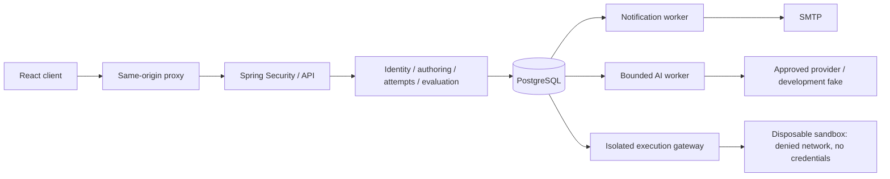
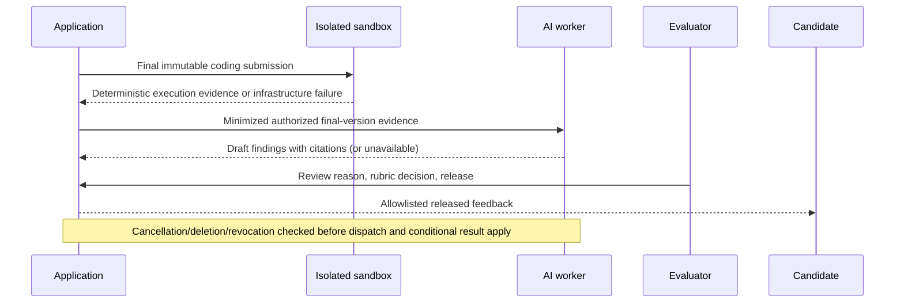

# Architecture and implementation plan

## Boundaries
Java 21 / Spring Boot 3.5 modular monolith; PostgreSQL is authoritative. React/Vite uses same-origin session cookies through a reverse proxy. PostgreSQL row locks serialize attempt mutations; no Redis or Kafka required at local MVP volume. Durable polling workers avoid broker dual-write failure. Code execution belongs on a separate sandbox host; the application only emits jobs. AI adapters have no tools or write access to attempt state.



```mermaid
sequenceDiagram
 participant R as Recruiter
 participant A as Application
 participant W as AI worker
 participant H as Human reviewer
 R->>A: Generate draft (source version, idempotency key)
 A->>A: Authorize + reserve budget + commit job
 W->>A: Claim durable lease
 W->>W: Approved provider call outside DB locks
 W->>A: Conditional draft write + validation findings
 H->>A: Approve expected version, reason
 A->>A: Revalidate dependencies and distinct reviewer
 R->>A: Publish pinned approved form
 Note over A,W: Timeout retries are bounded; duplicate completion cannot approve or publish
```

```mermaid
sequenceDiagram
 participant C as Candidate
 participant A as Attempt service
 participant D as PostgreSQL
 C->>A: Start claimed invitation + prerequisites
 A->>D: Lock invitation, create unique attempt and browser lease
 C->>A: Save expected revision + idempotency key
 A->>D: Lock attempt, reconcile server clock, persist answer/history/receipt
 D-->>C: Acknowledged revision
 Note over C,A: Browser closes; heartbeat grace consumes time
 A->>D: Scheduled reconciliation grants bounded interruption pause
 C->>A: Resume with owner session and new browser lease
 A->>D: Reconcile persisted active time, pause and deadline
 D-->>C: Answers, current position, authoritative remaining time
 C->>A: Submit
 A->>D: Finalize + deterministic scoring + asynchronous job references
 Note over A,D: Repeated submit returns the same final state
```



## Timer fairness
Heartbeat interval 10 seconds; detection grace 30 seconds. Grace is active time. After grace, each eligible interruption grants at most the configured per-pause allowance, constrained by total pause budget and count. Excess outage time consumes active budget. Absolute completion deadline always wins. All accounting derives from persisted server timestamps, never client claims. A server outage is indistinguishable from missing client heartbeats: this policy grants the same bounded pause; operational remediation must be audited separately. Row locking protects all reconciliation and answer writes. Expiry finalizer uses the same code path as API reads.

## Data model
Migrations are the authoritative physical schema. Tenant-owned resources carry organization_id. Composite foreign keys protect tenant relationships. Published assessment snapshots are immutable JSONB aggregates with pinned item IDs and keys; candidate projection explicitly allowlists fields. Answers are normalized by attempt/question and revisions append-only. Unique invitation-attempt and scoped idempotency constraints prevent duplicate writes. AI jobs/artifacts/decisions/usage are separate from attempts. Snapshot aggregates trade SQL-level per-field constraints for application validation and immutable reconstruction; full normalized taxonomy/rubric governance remains required before complete specification coverage.

## Security and operations
Same-origin HttpOnly session, CSRF on writes, BCrypt; invitation/verification secrets stored as SHA-256 digests. HTTPS termination is mandatory outside localhost. No provider endpoints supplied by clients. No candidate code executed on application hosts. Production runner requires independently validated gVisor/Firecracker or equivalently hardened isolation, no Docker socket in application, egress deny and resource limits. Local execution is disabled until a runner is configured; disabled is an explicit unavailable state, never a fake score.

## Phases
1. Requirements, state/permission rules, threat inventory and acceptance matrix.
2. Versioned schema, API, transaction boundaries and deployment topology.
3. Identity, authoring/invitation, durable attempts/timer/scoring, asynchronous AI governance.
4. Real-API React recruitment/candidate workspace and authoring review.
5. Unit/database/browser/security/AI acceptance checks; record actual results.
6. Compose, CI, example flow, runbooks and limitations. Missing production gates remain blocking.

## Implemented coding and release continuation

```mermaid
sequenceDiagram
  participant C as Candidate
  participant A as Attempt transaction
  participant D as PostgreSQL
  participant W as Coding worker
  participant G as Private sandbox gateway
  participant R as Evaluator
  C->>A: Submit with current owner/tab lease
  A->>D: Finalize answers + baseline + GRADE jobs atomically
  A-->>C: Submission acknowledged
  W->>D: Claim bounded job with lease token
  W->>G: Source and test inputs (no expected outputs)
  G-->>W: Bounded isolated execution evidence
  alt Infrastructure failure
    W->>D: Retry bounded times; evaluation remains pending
  else Successful evidence
    W->>D: Fenced result + deterministic grade in transaction
  end
  R->>D: Request optional feedback with consent and version references
  Note over D: AI worker is independent of saves and timing
  R->>D: Review feedback; reject stale evidence and self-review
  R->>D: Approve evaluation; optional bounded corrections with reasons
  R->>D: Explicit idempotent report release
  C->>D: Retrieve own released allowlisted snapshot
```

The sandbox gateway is a separate security boundary with no application credentials. Only its control-plane service account can create sandbox Jobs. Guest pods use gVisor, no service-account token, read-only root, nonroot UID, dropped capabilities, default-deny networking and bounded resources. A fifteen-minute sweeper removes labeled orphan Jobs/ConfigMaps after gateway crashes. This configuration still requires live isolation validation and approved deployment infrastructure.

Coding workers make remote requests outside database locks. A 600-second request deadline is bounded by a 660-second claim lease; expired claims can be reclaimed, and old responses cannot overwrite a newer lease. At most three attempts are made. Hidden outputs stay in the core application; candidate routes expose only sample jobs. Grade completion pins the immutable final answer revision.

Evaluation baseline and human-approved summary are separate. Every review stores a new evaluation version with adjustments/reasons; release stores a candidate-safe snapshot. Scoring revision changes invalidate pending AI feedback without rewriting old release records. Optional consent is checked at feedback generation, completion, review and inclusion in a release. Full deletion/withdrawal traversal of retained historical snapshots remains required work.
